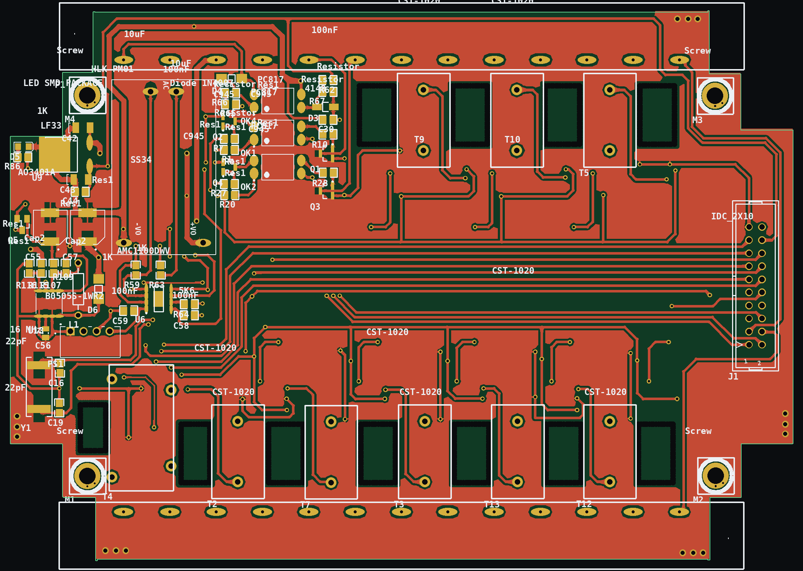
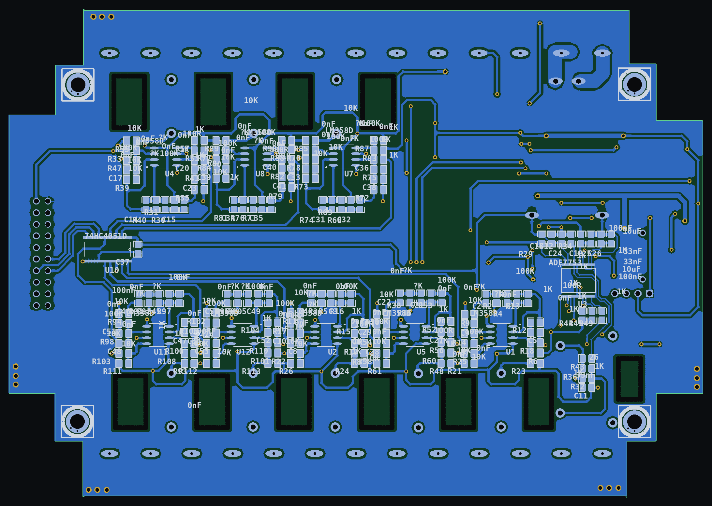
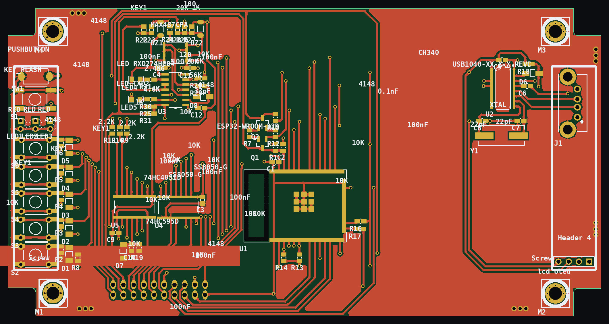
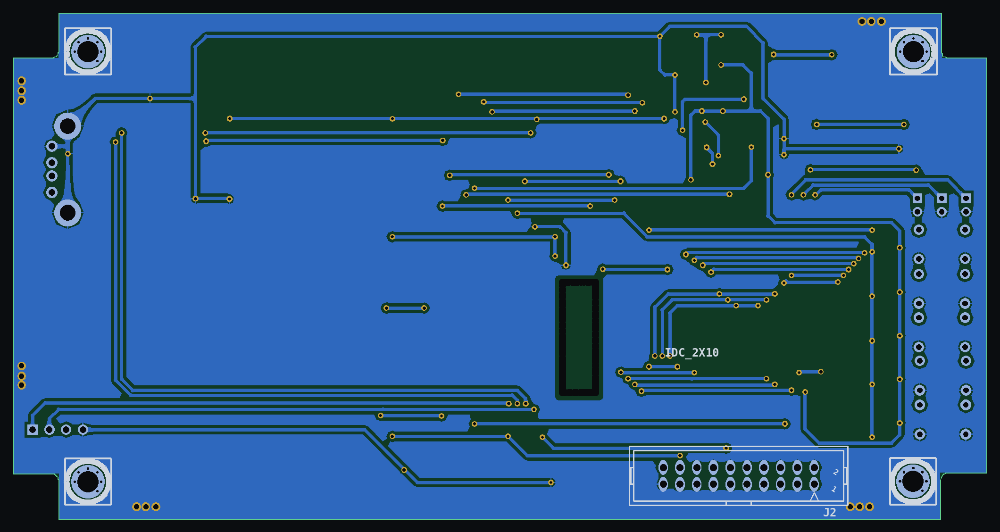
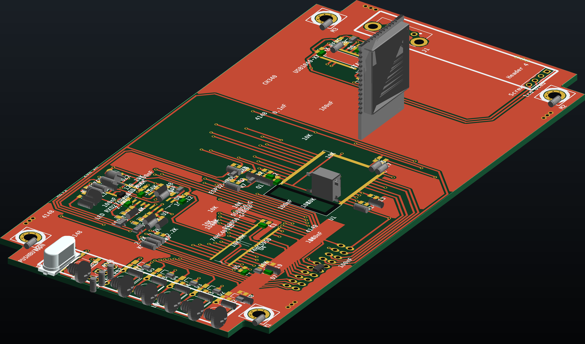
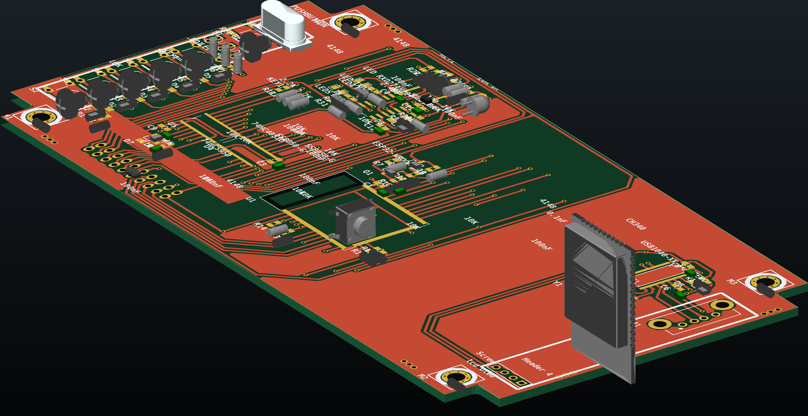
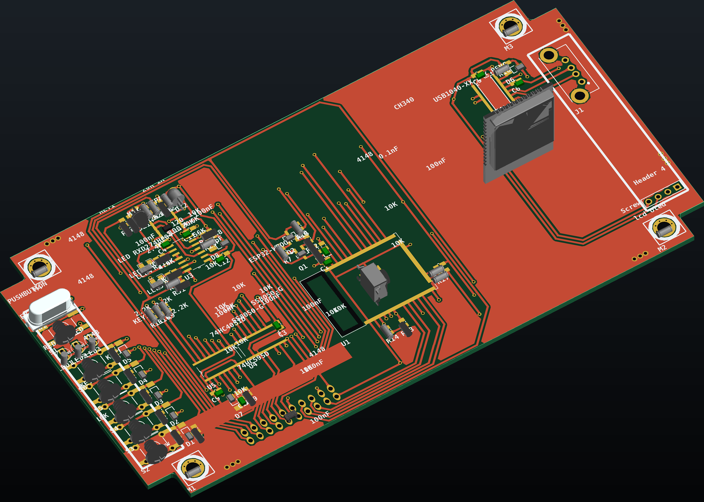

# Eight-Channel Energy Meter

Two-board electrical energy meter: a metering board that conditions eight clamp-on
current-transformer channels and one PCB current transformer into an ADE7753
energy-measurement IC, and an ESP32 controller board with USB-C and RS-485.

Altium Designer sources and board renders generated from the design data.



## Boards

| Board | Dimensions | Layers | Components | Nets | Function |
|---|---|---|---|---|---|
| Metering board (`PCB_Down`) | 152 × 106 mm | 2 | 218 | 149 | Current and voltage sensing, metering, isolated supplies |
| Controller board (`PCB Up`) | 154.7 × 83.8 mm | 2 | 81 | 70 | ESP32 host, USB-C, RS-485, user I/O |

The boards are joined by a 2.54 mm 2×10 IDC ribbon (`J1` on each), keeping the
mains-referenced metering section physically separate from the low-voltage
controller.

## Architecture

### Metering board

Signal chain: eight clamp CTs → per-channel LM358 conditioning → 74HC4051 8:1
multiplexer → ADE7753 current channel. The ADE7753 performs energy accumulation,
RMS and frequency measurement in hardware; its voltage channel measures the
supply through an isolated front end.

| Section | Devices | Function |
|---|---|---|
| Current sensing | 8 × ZMCT103C clamp CTs (`T2`–`T13`), CT1005A PCB CT (`T4`, 5 A / 5 mA) | One channel per load |
| Signal conditioning | 8 × LM358D (one dual op-amp per channel), 100 R / 1 K / 10 K / 100 K network, 33 nF / 100 nF / 0.1 nF | Burden, gain and anti-alias filtering |
| Channel selection | 74HC4051D 8:1 analog multiplexer | Scans the eight conditioned channels into the metering IC |
| Metering | ADE7753 (`U3`, SSOP-20) | Active/reactive energy, RMS, frequency; one current and one voltage channel |
| Voltage sense / isolation | AMC1100DWV (`U6`, SOIC-8 with thermal pad), PC817 opto-couplers | Isolated voltage measurement and signalling |
| Isolated supply | B0505S-1WR2 (`PS1`), 5 V→5 V 1 W DC/DC | Supplies the isolated measurement side |
| Power | HLK-PM01 off-line AC/DC 5 V module, MC34063AD switching regulator plus inductor, AO3401A P-FET | Mains-derived 5 V rail, auxiliary rail, reverse-polarity switching |
| Connectors | 2 × 13-way terminal blocks (`P1`, `P2`), 2×10 IDC (`J1`) | CT and voltage wiring, ribbon to the controller |

### Controller board

| Section | Devices | Function |
|---|---|---|
| Host | ESP32-WROOM-32D (`U1`) | Wi-Fi/BT, SPI/UART/I²C master |
| USB | CH340 USB-UART bridge, USB-C receptacle (`J1`, GCT USB1040) | Console and firmware download |
| Field bus | MAX487CPA | Half-duplex RS-485 |
| I/O expansion | 74HC595D shift register, 74HC4051D multiplexer, 74HC04 inverter | Indicator drive and key/input scanning |
| User interface | 5 × keys, 5 × LEDs, 2 × SS8050, 2 × 5 V zener | Front-panel operation |
| Interconnect | 2×10 IDC (`J1`), 4-pin header | Ribbon to the metering board |

## Schematic and PCB

Both boards are two-layer, through-hole-plated designs: no inner layers, no
controlled-impedance stack-up.

| | Metering board | Controller board |
|---|---|---|
| Outline | 152 × 106 mm, stepped ribbed edge for enclosure slots | 154.7 × 83.8 mm |
| Routing | 4344 track segments, 136 vias, 1560 pads | 3300 track segments, 147 vias, 547 pads |
| Placement | Double-sided: 154 of 218 parts on the bottom (metering IC and conditioning network), CTs and terminals on top | 80 of 81 parts on the top side |

Copper and silkscreen artwork, read from the `.PcbDoc` files:

| Metering board, top | Metering board, bottom |
|---|---|
|  |  |
| **Controller board, top** | **Controller board, bottom** |
|  |  |

## 3D views

Rendered from the STEP models embedded in the `.PcbDoc` files, placed on their
components, with the board surface textured from the copper and silkscreen artwork.

| View | Controller board |
|---|---|
| 3/4 front |  |
| 3/4 rear |  |
| High angle |  |

The metering board is shown as 2D artwork only: most of its components carry no
embedded STEP model, and its terminal-block models are stored off-origin, so a 3D
view would misrepresent the assembly. Parts without an embedded model are not drawn
in any render. Colours are a rendering choice, not the manufactured solder-mask
colour.

## Opening the design

**Altium Designer.** Open `hardware/metering-board/PCB_Down.PrjPcb` and
`hardware/controller-board/PCB Up.PrjPcb`. The schematic sheets are the only record
of component values; the PCB documents store footprints and placement.

**Without Altium.** The `tools/` directory reads `.PcbDoc` directly and regenerates
the images in this README:

```bash
pip install olefile pillow numpy cadquery-ocp

python3 tools/altium_pcb.py    hardware/metering-board/PCB_Down.PcbDoc
python3 tools/render_pcb_2d.py hardware/metering-board/PCB_Down.PcbDoc out/ --ppm 14
python3 tools/render_pcb_3d.py hardware/metering-board/PCB_Down.PcbDoc out/3d.png --az 34 --el 30
```

## Repository layout

```
hardware/metering-board/    PCB_Down.PrjPcb, PCB_Down.SchDoc, PCB_Down.PcbDoc
hardware/controller-board/  PCB Up.PrjPcb, pcb up.SchDoc, PCB Up.PcbDoc
renders/                    artwork and 3D views
tools/                      PcbDoc reader, artwork renderer, STEP-body 3D renderer
```

## Limitations

* No schematic PDF exists for either board; the `.SchDoc` sources are included and a
  schematic view requires Altium.
* No firmware, calibration procedure or communication protocol is included.
* No measurement data exists, so no accuracy class or error figure is claimed.
* The per-channel network values and the assignment of the AMC1100 to the voltage
  path are inferred from the placed parts and packages, not read from a schematic
  export.
* The metering board outline follows an off-the-shelf extruded enclosure; that
  third-party drawing is not published here.
* Geometry, placement and net counts are reported as they stand in the design files.
  Nothing was re-simulated, DRC-checked or manufactured here.

## Authorship and credits

Circuit design, schematic capture and PCB layout: **Ali Shavakhi**.

Component symbols and footprints come from the shared Altium libraries the project
was built with, and their per-component credits are retained in the files:
**ControTec** parts authored by *Abbas Basereh* and *Saeid Jorablo*, and **PicPars**
parts by *Seyed Mohsen Ghasemian*; the remainder are stock Altium Limited parts.
These names identify library authors, not board designers.

## Licence

MIT for the `tools/` source code — see [`LICENSE`](LICENSE). The hardware design
files are published for reference and portfolio review under
[`LICENSE-SCOPE.md`](LICENSE-SCOPE.md).

These boards are not certified. Any hardware built from these files must be
reviewed and tested by a competent engineer before connection to mains.
